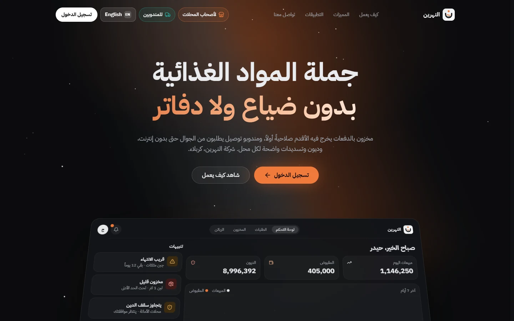
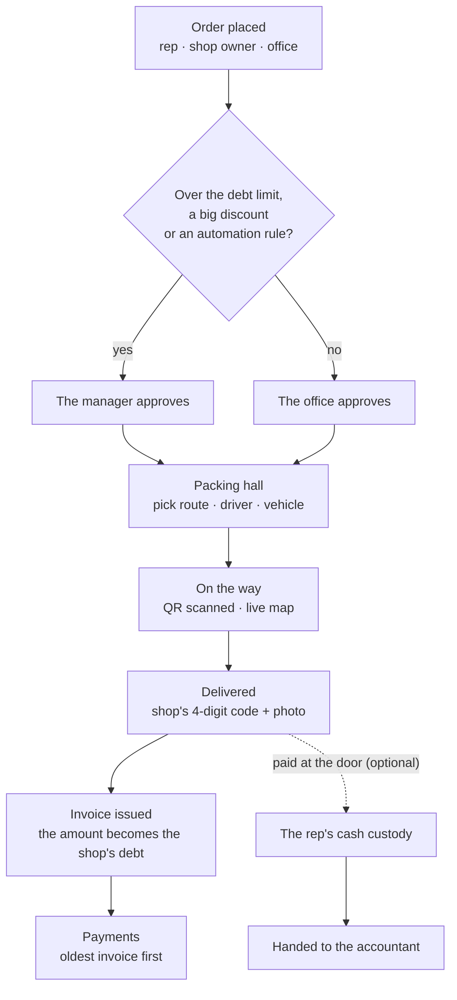
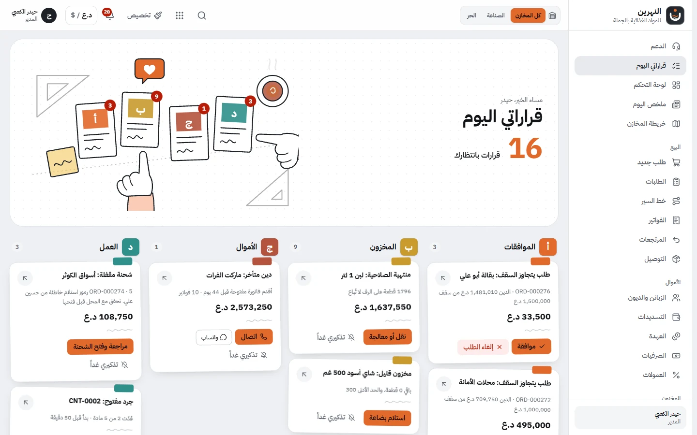
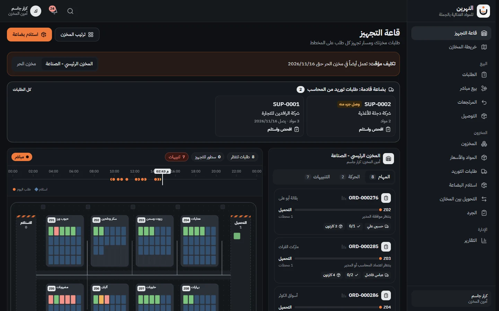
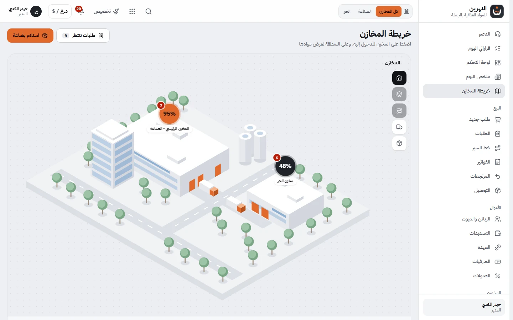
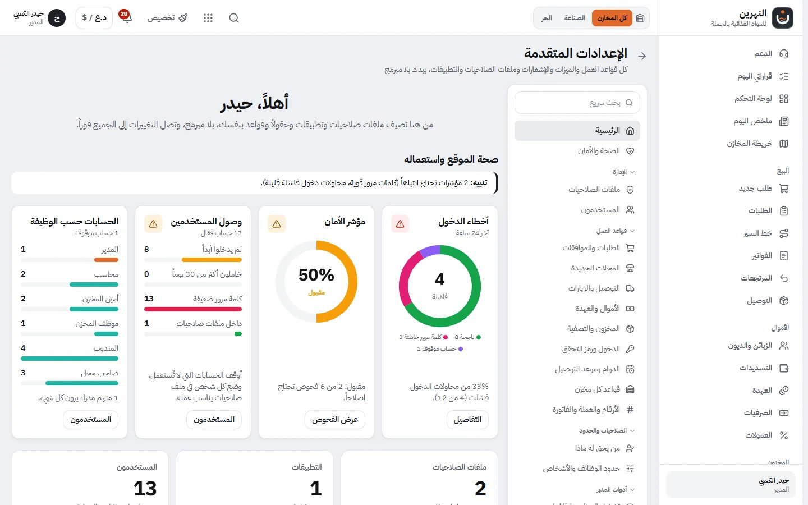
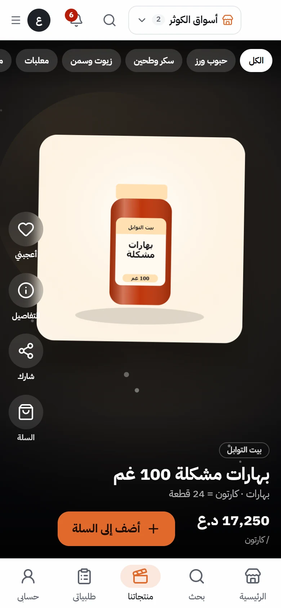
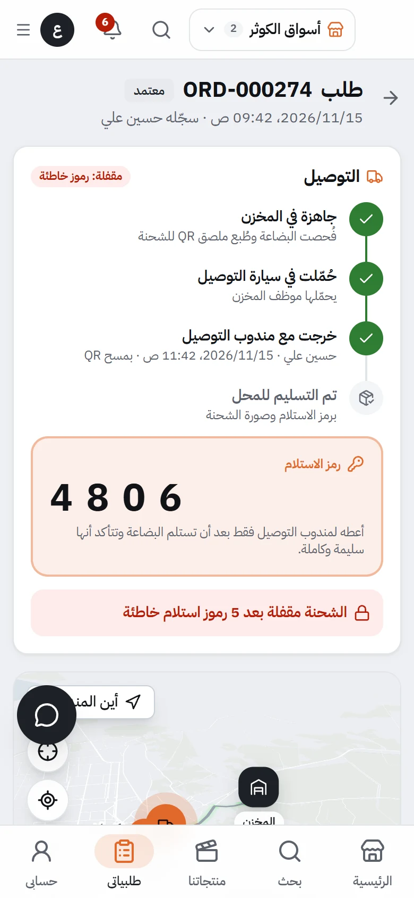
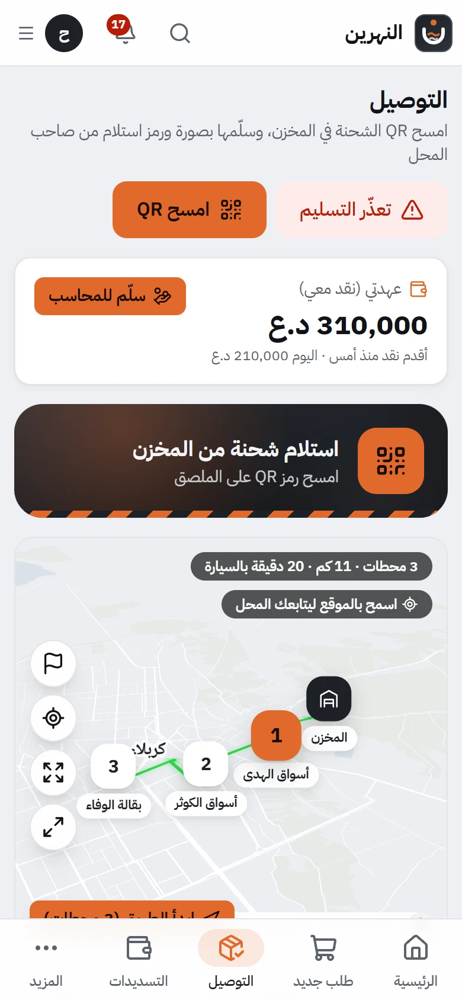
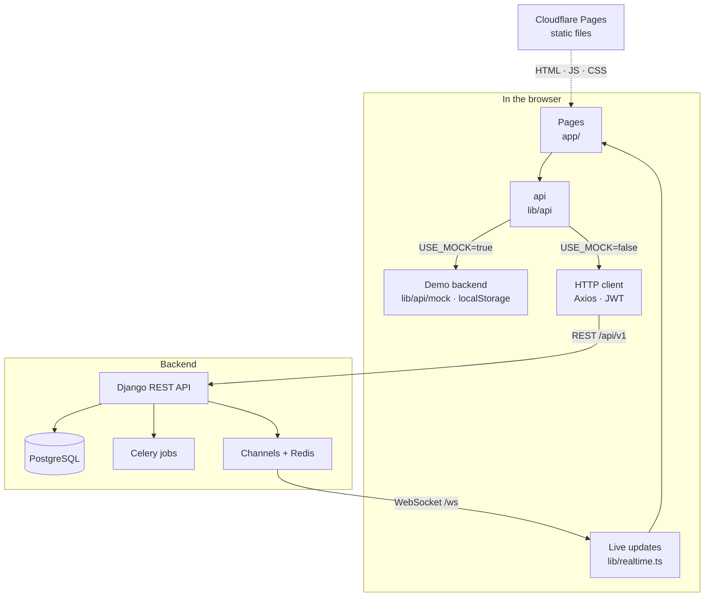

<div align="center">


# Al-Nahrain · النهرين

**One platform for a food wholesale company: batch stock, orders, delivery, debts and payments.**

An Arabic-first web app for the office and the warehouses, plus two installable phone apps:
one for shop owners, one for sales and delivery reps.

[](https://nextjs.org)
[](https://react.dev)
[](https://www.typescriptlang.org)
[](https://tailwindcss.com)
[](https://pages.cloudflare.com)
[](#the-three-apps)

[Live site](https://aln.ama8.uk) · [Screenshots](#screenshots) · [Getting started](#getting-started) · [Backend contract](docs/backend.md) · [Site guide (Arabic)](docs/site-guide.md)

</div>

<br />



## Contents

- [About](#about)
- [The three apps](#the-three-apps)
- [Who uses it](#who-uses-it)
- [Features](#features)
- [How an order flows](#how-an-order-flows)
- [Screenshots](#screenshots)
- [Tech stack](#tech-stack)
- [Architecture](#architecture)
- [Getting started](#getting-started)
- [Configuration](#configuration)
- [Scripts](#scripts)
- [Project structure](#project-structure)
- [Deployment](#deployment)
- [Quality](#quality)
- [Documentation](#documentation)

## About

Al-Nahrain Wholesale Foods (شركة النهرين للمواد الغذائية بالجملة) sells food to shops and minimarkets in
Karbala, Iraq. It works from two warehouses, through reps who visit the shops. Before this platform the work
ran on paper and Excel: stock expired on the shelves, reps sold items that were not in stock, and nobody knew
exactly what each shop owed.

The platform puts all of it in one place, and each person sees only their own part:

- **Stock by batch.** Every delivery from a supplier is a batch with its own expiry date and cost. The oldest
  expiry always leaves first, and expired stock can never be sold.
- **Orders are never lost.** Reps take orders on their phones, even without internet. An order is sent when
  the connection comes back, and never twice.
- **Debts are clear.** Most sales are on credit. Every shop has a debt limit, and payments go to its oldest
  invoice first. Nothing about money can be deleted, only reversed, with a reason.

## The three apps

| App | Address | For | Notes |
|---|---|---|---|
| **Office and warehouses** | `/` | Everyone in the company | 51 screens. A side menu on a computer, a bottom bar on a phone. |
| **Shop owners' app** | `/client` | Shop owners | Installable (PWA), with its own icon and landing page. Order, track, pay, chat. |
| **Reps' app** | `/driver` | Sales and delivery reps | Installable (PWA) and works offline. Scan, deliver, collect. |

The phone apps reuse the same screens in a phone-first frame, so a fix in one place reaches all three.

## Who uses it

| Role | Starts on | Main work |
|---|---|---|
| **Manager** (the owner) | Today's decisions | Sees everything. Approves debt-limit overrides, big discounts and large expenses. Manages users, prices, settings and the advanced setup. |
| **Accountant** | Accounts | Invoices, payments, debts, expenses, cash custody, the dollar rate, commissions and reports. |
| **Warehouse keeper** | Packing hall | Prepares their warehouse's orders, receives goods, moves stock between warehouses, runs stocktakes. Never sees debts. |
| **Warehouse staff** | Home | Helps prepare orders and answers shop owners' messages. |
| **Sales rep** | The day's route | Visits their shops, takes orders (also offline), collects payments. Never sees purchase prices. |
| **Delivery rep** | Deliveries | Scans the shipment's QR, delivers with the shop's code and a photo, takes cash at the door and hands it to the accountant. |
| **Shop owner** | Shop | Orders from the store, follows the delivery on a map, reads the statement, pays online, chats with support. |

On top of the roles, the manager can build **permission profiles** that take pages or actions away from
particular people (see [Control without a programmer](#control-without-a-programmer)).

## Features

### Stock and warehouses

- Batches with an expiry date and a purchase cost. The earliest expiry is picked first, and expired batches
  can't be sold.
- Alerts for near-expiry, expired, below-minimum and slow-moving items, and a suggested clearance discount
  for stock close to expiry.
- Receiving against supply orders, with shortages and extras counted on arrival.
- Transfers between warehouses that never lose or double-count stock. Stocktakes keep a reason for every
  difference.
- A packing hall that draws each order's pick route on the warehouse plan, and a map of all the warehouses.
- Vehicles with a maximum load: a heavy order is split across several vehicles.
- A batch can be put on hold after a complaint.

### Orders and sales

- Orders come from reps, shop owners and the office, plus counter sales at the warehouse.
- Stock is reserved while an order waits for approval (24 hours by default), and released if nobody approves it.
- Price tiers per customer, special prices and scheduled price changes. Old invoices never change.
- An order over the shop's debt limit, with a big discount, or caught by an automation rule waits for the manager.
- Reps' day routes on the map, with each visit checked against the shop's location.
- For shop owners: saved lists, "order like last time", favourites, and "tell me when it's back in stock".

### Delivery

- Shipment labels with a QR code and a Code 128 barcode, printed in the warehouse.
- The delivery rep scans the label to take the shipment, and the shop owner follows it live on the map.
- Delivery needs the shop owner's 4-digit code and a photo. Five wrong codes lock the shipment.
- The day's stops on the road map, with the distance and the driving time.
- The shop can pay at the door in cash, by Qi Card or by ZainCash: all of it, part of it, or nothing. Cash
  stays in the rep's custody until the accountant confirms the handover.
- "Couldn't deliver" with a reason, and a delivery rating from the shop.

### Money

- The invoice is made when the goods are delivered, and the amount becomes the shop's debt.
- Payments in cash, by transfer or online (Qi Card, ZainCash) go to the oldest invoice first.
- Nothing is deleted. A payment is reversed, in full or in part, with a reason and the name of whoever did it.
- A return can never exceed what was sold. Good items go back to stock, and damaged ones are recorded as damaged.
- Credit notes, refunds, customer statements and debt ageing.
- Expenses need the manager's approval above a set amount. The dashboard shows the month's profit after expenses.
- Rep commissions per item, counted only on money actually paid.
- A daily dollar rate, with any amount shown in dinars or dollars.
- Thermal receipts (80 or 58 mm), Excel export, and WhatsApp sharing for invoices, receipts and statements.

### Control without a programmer

The manager's **advanced settings** work like a CRM's setup screen:

- **Permission profiles** inside a role: hide pages, hide profit or debts, give read-only access, set login
  hours, and block actions.
- **Custom fields** on customers, items and orders, with who may see and edit each one.
- **Automation rules** ("when… if… then…") that notify people or hold an order or expense for approval,
  with a log of what each rule did.
- **An app manager**, a **health and security** page (failed logins, a security score, idle accounts, weak
  passwords) and a full **audit log**.
- **A customization mode**: reorder the menu, the dashboard and table columns, and change texts, colours
  and the logo.

### Everyday use

- Every open screen updates by itself when data changes. New orders and messages also play a sound and show
  a phone notification.
- Reps can work offline: orders and payments wait on the phone and are sent when the internet returns.
- Quick search (Ctrl+K), sortable tables that remember their filters, and a warning before leaving a form
  that isn't saved.
- A guided tour for each role, adjustable text size, Arabic (right to left) and English, and light and dark themes.
- Support chat between shop owners and the company. Sign-up, password reset and phone changes use a one-time code.

## How an order flows



While it waits for approval, the order holds its stock. If nobody approves it in time, it expires and the stock
is released. The demo backend applies exactly these rules (`lib/api/mock/rules.ts`), and
[`docs/backend.md`](docs/backend.md) describes them for the real backend.

## Screenshots

<table>
  <tr>
    <td width="50%">
      
      <p align="center"><b>Today's decisions</b>: the manager's inbox</p>
    </td>
    <td width="50%">
      
      <p align="center"><b>Packing hall</b>: pick routes on the warehouse plan (dark theme)</p>
    </td>
  </tr>
  <tr>
    <td width="50%">
      
      <p align="center"><b>Warehouse map</b>: every warehouse at a glance</p>
    </td>
    <td width="50%">
      
      <p align="center"><b>Advanced settings</b>: profiles, fields, rules and security</p>
    </td>
  </tr>
</table>

<table>
  <tr>
    <td width="33%">
      
      <p align="center"><b>Shop app</b>: browse and order</p>
    </td>
    <td width="33%">
      
      <p align="center"><b>Shop app</b>: the delivery and its code</p>
    </td>
    <td width="33%">
      
      <p align="center"><b>Reps' app</b>: cash custody and the route</p>
    </td>
  </tr>
</table>

## Tech stack

**Front end** (this repository)

| Area | Technology | What it does here |
|---|---|---|
| Framework | Next.js 16 (App Router), React 19 | Pages and routing, exported as static files |
| Language | TypeScript (strict) | One set of types for every API call (`lib/api/types.ts`) |
| Styling | Tailwind CSS 4, IBM Plex Sans Arabic | A right-to-left first design with light and dark colour tokens |
| HTTP | Axios | One client that adds the login token and turns errors into messages |
| Live updates | WebSocket, BroadcastChannel | Refresh every open screen when data changes |
| Maps | MapLibre GL, OpenFreeMap tiles, OSRM | The live delivery map and road routes |
| Charts | Recharts | The dashboard and reports |
| Scanning | BarcodeDetector API, jsQR, ZXing | Shipment QR codes and item barcodes from the phone camera |
| Labels and files | qrcode, our own Code 128 encoder, our own XLSX writer on fflate | Printed labels and Excel export |
| Motion | Motion, View Transitions API | Page and element animations |
| Drag and drop | dnd-kit | The customization mode |
| Icons | Lucide | Every icon in the interface |
| Phone apps | Web App Manifest, Service Worker, Web Push, Web Audio | Installing, notifications and alert sounds |
| CI and hosting | Jenkins, Cloudflare Pages | Lint and build on every push; static hosting |

**Back end** (a separate Django project, [team-1-aljadreyah/backend2](https://github.com/team-1-aljadreyah/backend2))

Django 5.2 with Django REST Framework and SimpleJWT, PostgreSQL 16, Redis 7, Django Channels on Daphne for
the WebSocket, Celery for scheduled jobs, Gunicorn and Docker.

## Architecture

The site is a static single-page app. `npm run build:pages` exports every page as plain HTML, JS and CSS,
Cloudflare Pages serves those files, and all data is loaded in the browser.

Pages never call the network themselves. They call `api` (`lib/api/index.ts`), which is either the **demo
backend** or the **HTTP client**, chosen at build time by `NEXT_PUBLIC_USE_MOCK`. Both have the same
interface, so switching to the real backend changes no page.



| Module | What it does |
|---|---|
| `lib/api/http.ts` | Every call to the real API: paths, bodies and answers. Offline-safe requests carry an `Idempotency-Key`. |
| `lib/api/mock*` | The demo backend: the same calls and every business rule, with the data kept in `localStorage`. It is also the reference for the real backend. |
| `lib/api/types.ts` | The data types shared by both backends and all pages. |
| `lib/realtime.ts` | The WebSocket client: topics, and reconnecting after 1 s, 2 s, 4 s… up to 30 s. |
| `lib/live.ts` | Reloads what is on screen when data changes, from the WebSocket or another tab. |
| `lib/offline.ts` | The reps' offline queue for orders and payments. |
| `lib/access.ts`, `lib/auth.ts` | Roles, permission profiles, apps, the session and each role's home page. |
| `lib/i18n.tsx` | Arabic and English, with number, money and date formatting. |
| `lib/alert-sound.ts`, `lib/phone-notify.ts`, `public/sw.js` | Alert tones made with Web Audio, and phone notifications through the service worker. |
| `components/ui.tsx`, `components/shell.tsx` | The design system, and the frame around every page. |

## Getting started

You need **Node.js 22** or newer and npm.

```bash
git clone https://github.com/team-1-aljadreyah/project-2.git
cd project-2
npm install
cp .env.example .env
npm run dev
```

Open http://localhost:3000. With the default `.env` (`NEXT_PUBLIC_USE_MOCK=true`), the whole system runs in
the browser on demo data, so no backend is needed:

- The login page has a one-tap button for each demo person: the manager, the accountant, both warehouse
  keepers, a staff member, three reps and a shop owner.
- The data starts with 45 days of activity and a ready example of every feature.
- Each browser keeps its own data. Tabs of the same browser share it and update each other live, so you can
  open one tab per person and follow an order from the shop all the way to delivery.
- To start over: account menu → «إعادة البيانات التجريبية» (reset the demo data).

To work against a real backend, set `NEXT_PUBLIC_USE_MOCK=false`, `NEXT_PUBLIC_API_URL` and
`NEXT_PUBLIC_WS_URL` in `.env`, then restart `npm run dev`.

## Configuration

| Variable | Example | Meaning |
|---|---|---|
| `NEXT_PUBLIC_USE_MOCK` | `true` | `true`: the demo backend in the browser. `false`: the real API. |
| `NEXT_PUBLIC_API_URL` | `https://api.example.com` | The backend's address, without `/api/v1` (it is added). |
| `NEXT_PUBLIC_WS_URL` | `wss://api.example.com/ws` | Live updates. When empty, they only travel between the tabs of one browser. |
| `NEXT_PUBLIC_VAPID_KEY` | | Optional. The public Web Push key, so phones get notifications with the app closed. |

- `NEXT_PUBLIC_*` values are built into the files and anyone can read them in the browser. Never put a secret in them.
- `.env` is ignored by git, and `.env.example` is its template.
- `.env.production` holds the live site's public settings and is read by every production build. A variable
  set in the build's environment still wins.

## Scripts

| Command | What it does |
|---|---|
| `npm run dev` | The development server at http://localhost:3000 |
| `npm run build:pages` | The static export into `out/`, for Cloudflare Pages |
| `npm run build` | A production build that runs on a Next.js server |
| `npm start` | Serves the output of `npm run build` |
| `npm run lint` | ESLint |
| `npm run realtime` | A local WebSocket relay at `ws://localhost:8787`, to try live updates between devices without the backend ([docs/realtime.md](docs/realtime.md)) |

## Project structure

```text
app/
├── (app)/              the office and warehouse app (51 screens)
├── client/             the shop owners' phone app: its landing page and screens
├── driver/             the reps' phone app: its landing page and screens
├── login/, register/   sign-in, and shop sign-up with a one-time code
├── pay/qi/             a stand-in for the Qi Card payment page in the demo
└── page.tsx            the public landing page
components/             the interface parts (ui.tsx is the design system, shell.tsx the app frame)
lib/
├── api/                the api switch, the HTTP client, the shared types and the demo backend (mock/)
├── realtime.ts         the WebSocket client
├── live.ts             refreshing screens when data changes
├── offline.ts          the reps' offline queue
├── access.ts           roles, permission profiles and apps
└── i18n.tsx            Arabic and English
public/                 app icons, manifests, the service worker (sw.js), Cloudflare's _redirects
realtime/server.mjs     the local WebSocket relay
scripts/                build helpers
docs/                   guides, the backend contract and the screenshots
```

## Deployment

The site has no server code: every page runs in the browser, so Cloudflare Pages serves it as plain files.

**With Git** (Cloudflare dashboard → Workers & Pages → Create → Pages → Connect to Git):

| Setting | Value |
|---|---|
| Framework preset | None |
| Build command | `npm run build:pages` |
| Build output directory | `out` |
| Environment variable | `NODE_VERSION` = `22` |

The live settings come from `.env.production`. A variable set in Cloudflare (Settings → Environment variables)
overrides it. `NEXT_PUBLIC_*` values are built into the files, so deploy again after changing one. The backend
must allow the site's address in its CORS settings.

**From your computer:**

```bash
npm run build:pages
npx wrangler pages deploy out
```

To try the Cloudflare build locally, run `npm run build:pages`, then `npx wrangler pages dev out`, and open
http://localhost:8788.

**A demo build** (the data in each visitor's browser, no backend):

```bash
NEXT_PUBLIC_USE_MOCK=true NEXT_PUBLIC_WS_URL= npm run build:pages
```

**How the static build works**

- `npm run build:pages`, or Cloudflare (which sets `CF_PAGES=1`), exports the site into `out/`. `npm run dev`
  stays a normal Next.js server.
- Detail pages (`/orders/123/`, `/invoices/45/`…) are built once, as `_`. `public/_redirects` serves that page
  for every id, and the page reads the id from the address bar (`useIdParam` in `lib/utils.ts`).
- `scripts/flatten-segments.mjs` copies Next's prefetch files to the flat names the browser asks for, so a
  plain file host never answers 404.
- Cache Components (partial pre-rendering) needs a Next.js server, so it is on in development and off in the export.

## Quality

- TypeScript in strict mode, and ESLint with the Next.js rules.
- Jenkins runs `npm ci`, `npm run lint` and `npm run build` on every push.
- Lighthouse, on 16 pages with both phone and desktop settings: 100 for accessibility, best practices and SEO
  on every page, and 99–100 for performance on desktop.
- The interface hides what a role may not see and blocks what it may not do, but **the server is the judge**.
  [`docs/backend.md`](docs/backend.md) lists every rule the backend must enforce.

## Documentation

| Document | Language | What's in it |
|---|---|---|
| [docs/backend.md](docs/backend.md) | English | The backend contract: roles, business rules, permissions, live updates and every endpoint |
| [docs/realtime.md](docs/realtime.md) | English | The live updates protocol (WebSocket) |
| [docs/site-guide.md](docs/site-guide.md) | Arabic | What was built, how each part works, and answers to common questions |
| [docs/presentation.md](docs/presentation.md) | Arabic | A step-by-step demo, with one browser tab per person |
| [docs/app-identity.md](docs/app-identity.md) | English | The phone apps' visual identity |

## License

Private project. All rights reserved.
